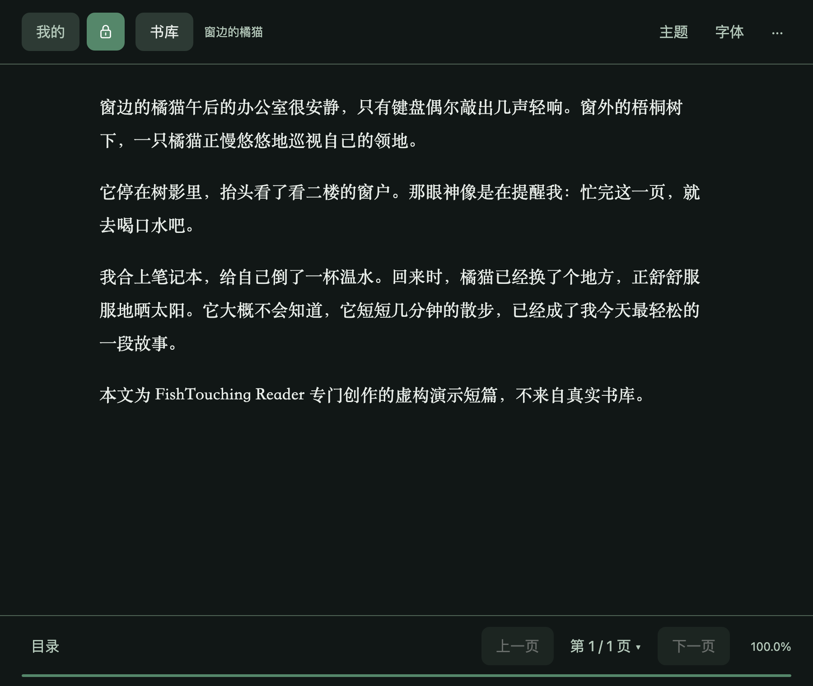
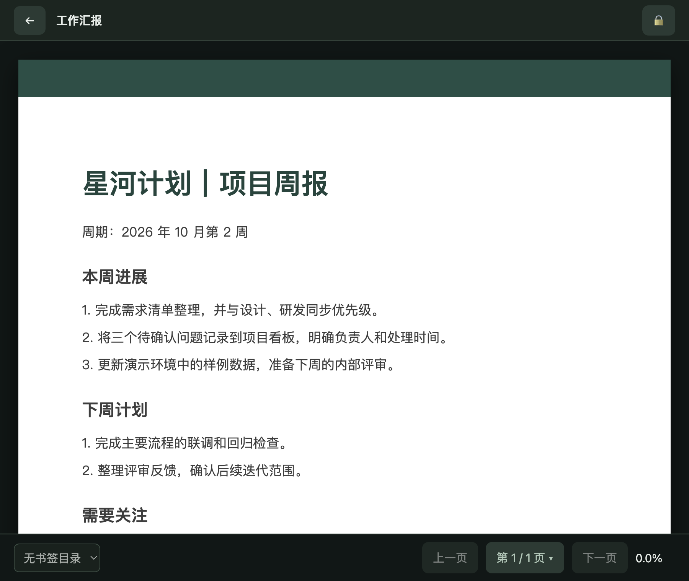
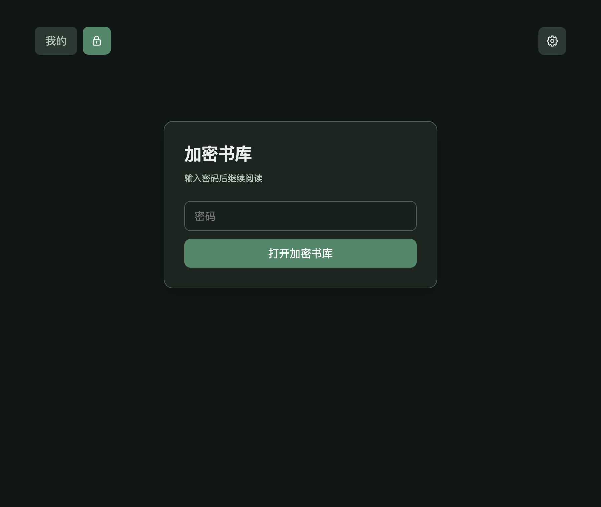
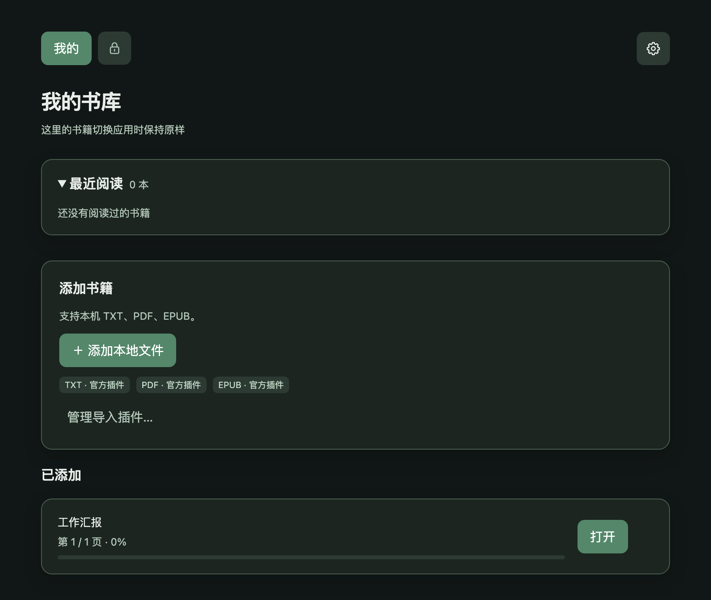

# FishTouching Reader

**还在担心上班摸鱼看小说时，有人突然走过来？** 切到别的应用，还要手忙脚乱地关掉阅读窗口？在 Dock、任务栏或应用切换列表里看到名字和图标，就怕别人猜到你在做什么？

FishTouching Reader 是一款 macOS 和 Windows 本地阅读器，核心是两件事：**切出加密阅读时自动切换画面**，以及**用不同密码创建、切换独立的加密书库**。你可以把工作 PDF 放在「我的书库」，把私下阅读的内容放进加密书库；每个加密书库分别保存书籍和阅读进度。**书库数据全部保存在本机**，应用不会把导入的书籍上传到云端。

**[下载 macOS 版](https://github.com/YouDiSN/fishtouching-reader/releases/latest)** · **[下载 Windows x64 版](https://github.com/YouDiSN/fishtouching-reader/releases/latest)** · [查看所有版本](https://github.com/YouDiSN/fishtouching-reader/releases)


> 演示图使用 [`demo/fixtures`](demo/fixtures) 中专门创作的虚构短篇和工作文档。为保护个人书库，画面是基于实际界面制作的示意素材，没有录制真实书籍或用户数据。

## 亮点一：切出加密阅读，自动切换画面

1. 在「我的书库」导入一份 PDF，比如演示用的 [`工作汇报.pdf`](demo/fixtures/工作汇报.pdf)；在加密书库导入小说 TXT。
2. 在加密书库切换到其他应用时，阅读器会切到「我的书库」。如果正在阅读加密书籍，应用还会清除加密正文，并打开**最近导入的普通 PDF**。
3. 回到阅读器，点击锁图标并输入密码，就能回到先前的加密书籍和阅读进度。如果当时看的是「我的书库」中的普通内容，失焦不会触发切换。

| 阅读加密短篇 | 失焦后打开工作 PDF |
| --- | --- |
|  |  |

| 返回后解锁 | 「我的书库」示例 |
| --- | --- |
|  |  |

想试一遍？[`demo/fixtures`](demo/fixtures) 中备好了 `摸鱼.txt`、`正式.txt`、`正式-会议纪要.txt` 和 `工作汇报.pdf`。它们都是演示文件，不包含个人书库内容。

## 亮点二：一个入口，按密码切换独立加密书库

想把不同类型的书分开放？在**设置 → 密码与隐私 → 添加独立书库**中，输入现有加密书库的密码，再为新书库设置一个**不同的密码**。目前最多可创建 **2 个加密书库**（原书库和 1 个独立书库），另有无需密码的「我的书库」。

切换时，先回到「我的书库」，点击锁图标，在同一个解锁页输入**想进入的书库的密码**；应用会打开对应书库，无需选择书库名称。每个加密书库有各自的密码、加密密钥、书目和阅读进度。切出任意加密书库时，都会触发上面的自动切换；回来输入对应密码，如果该书库当时正在阅读一本书，会回到那本书的进度。输入另一书库的密码，则进入另一书库。

锁定页不会列出你创建了几个加密书库，也不会展示里面的书名。旁人从锁定页面只看到同一个入口；你还藏着哪些内容、藏了多少，只有自己心里有数。

需要整理书籍时，可以在解锁后选择“移至另一书库”，输入目标书库的密码。应用会先复制并验证书籍与进度，再移除原书库中的副本。修改密码只影响当前书库；从「我的书库」打开设置时，修改的是原加密书库的密码。

## 名称和图标随时可改

首次启动可以设置应用名称和图标，之后也能随时点击右上角齿轮更改。你可以换上工作应用风格的名称和图标，让它在 Dock、任务栏和应用切换列表里看起来像工作应用。除了 10 个内置图标（默认是摸鱼图标），也可以上传自己的图片。新名称会在重启应用后显示在 macOS 的 Dock／`Command + Tab` 或 Windows 的任务栏／`Alt + Tab`；图标选择后会立即更新。

自定义图标建议使用至少 **1024 × 1024 像素**的正方形 PNG 原图。删除自定义图标只会移除应用保存的副本，不会删除原始图片。名称留空保存，会恢复默认的 `FishTouching Reader`。macOS 设置会在退出后重命名本机 `.app` 文件夹；Windows 设置仅改变窗口和任务栏显示，`.exe` 文件名及任务管理器进程名仍为默认名称。

## 阅读导航

- 底部常驻上一页、下一页和阅读进度；点击页码可直接跳转，跳转后可返回原位置。
- TXT 自动识别规范的章节标题，目录支持按章号或名称搜索；PDF 使用文件自带的书签目录。
- 字号与排版集中在“阅读设置”，导出等操作收进更多菜单。阅读页和书库页不再显示手动锁定按钮，失焦自动锁定仍然保留。
- TXT 按原文段落分页，调整字号或排版不会改变页码。自动章节识别可能不适用于没有独立标题行的文章。

## 导入插件

TXT、PDF、EPUB 为内置的**官方插件**。添加本地文件时自动匹配已启用的插件；三个官方插件默认启用，在书库“管理导入插件…”中可以启停。社区插件列表、安装和网址导入入口暂时隐藏，待功能完善后再开放。

外部安装的规则始终标记为**社区插件**，不能自行声明官方身份。支持本地文本扩展和三个实验性网站适配器：番茄、七猫、起点免费书源。安装或更新后默认停用，需手动启用；停用或移除不会删除已导入的书籍和进度。

网站导入只处理公开可解析的正文，不绕过登录、验证码或付费限制。番茄与七猫已通过真实免费章节的解析、入库和读回抽查；起点当前仍受访问验证限制。**抽查成功不代表能下载全书**。目录链接数不代表可下载章节数；所选章节全部验证成功后才保存，书名注明范围。

### 开发和安装社区插件

> 以下为开发说明，当前界面暂不开放社区插件入口。共享界面 `Resources/index.html` 中的 `communityPluginsVisible` 开关控制入口显示，当前为 `false`。

社区插件采用 UTF-8 JSON 清单，不加载外部 JavaScript、二进制程序或依赖。

- **开发格式**：本地文本使用 `schemaVersion: 1`、`parser: "txt"`；网站规则使用 `schemaVersion: 2`、`parser: "website"`，并指定 `adapter: "fanqie"`、`"qimao"` 或 `"qidian"`。
- **字段规范**：必须填写 `id`（以 `community.` 开头）、`name`、`version`（如 `1.0.0`）、`author`、`description` 和 `extensions`。网站规则的 `extensions` 为 `[]`。禁止未知字段及自行声明官方身份或权限。
- **ZIP 格式**：根目录只放一个 `manifest.json`，不含其他文件；ZIP 最大 256 KiB，清单最大 64 KiB。
- **地址安装**：打开“管理导入插件…”，粘贴 JSON 或 ZIP 的 **HTTPS 直链**，点击“从地址安装”，查看来源和权限后确认，再手动启用。地址须直接返回文件，不能是 GitHub 预览页或需要重定向、登录的地址。
- **本地安装**：同一页面点击“从 ZIP / JSON 安装…”，选择文件并确认。

完整 JSON 示例、字段长度约束、打包命令、安全限制和测试方法见 **[社区插件开发指南](docs/plugins/README.md)**。参考规则：[番茄](docs/plugins/sources/fanqie.json)、[七猫](docs/plugins/sources/qimao.json)、[起点](docs/plugins/sources/qidian.json)。新增网站解析器需修改宿主代码并随应用更新，不能通过插件任意执行代码。

开发模式开启入口后，可选择本地规则包安装：[番茄 ZIP](docs/plugins/packages/fanqie.zip)、[七猫 ZIP](docs/plugins/packages/qimao.zip)、[起点 ZIP](docs/plugins/packages/qidian.zip)。

发布版保留实现，但暂时隐藏社区相关入口。

## 其他功能

- 支持导入本地 TXT、PDF、EPUB；EPUB 按阅读顺序显示文字，插图暂不在阅读界面显示。加密书库会保存原始 EPUB，可从书籍页面导出；加密书库中的目录和内容均加密保存。「我的书库」的普通文件不加密。
- 「我的书库」和每个加密书库都有最近阅读、阅读进度、搜索和按字数排序。“最近阅读”的“移出最近”只隐藏该记录，书籍和进度会保留；再次阅读会重新出现。“已添加”或“全部书籍”中的移除会删除应用管理的副本、目录记录与进度，**不会删除最初导入的原始文件**。
- macOS 用 `Control + Option + H` 显示或隐藏窗口、`Command + ,` 打开设置；Windows 用 `Ctrl + Alt + H` 和 `Ctrl + ,`。菜单栏或系统托盘也提供入口。

## 下载和安装

**macOS：**从[最新版本](https://github.com/YouDiSN/fishtouching-reader/releases/latest)下载 DMG 磁盘映像，打开后将 `FishTouching Reader.app` 拖入“应用程序”文件夹。也可以下载已公证的 ZIP 压缩包。发行包适用于 **Apple Silicon（arm64）**，最低目标系统版本为 **macOS 13**。通过 Homebrew 安装的 libsodium 可能包含面向较新系统构建的对象文件；旧版 macOS 的兼容性尚未经过实机验证。

从 v1.0.2 起，macOS 发行包使用苹果开发者证书签名并完成公证。首次打开时仍可能出现系统确认提示。

macOS 版通过 Sparkle 检查更新，也可以在应用菜单中手动检查。首次使用自动更新功能前，需手动安装支持该功能的版本；v1.0.1 无法自行更新。签名配置和验证范围见[签名与发布说明](docs/macos-signing.md)。

**Windows：**从[最新版本](https://github.com/YouDiSN/fishtouching-reader/releases/latest)下载 Windows x64 便携 ZIP，完整解压后运行 `FishTouching Reader.exe`。当前 Windows 包未进行代码签名，SmartScreen 可能提示未知发布者；该版本已在 GitHub 的 Windows 运行环境中通过阅读、失焦切到 PDF、锁定和恢复的自动测试，尚未在用户 Windows 电脑上人工验收。两个平台目前各有独立书库，不自动同步。详见 [Windows 说明](windows/README.md)。Windows 安装版支持应用内更新；旧 ZIP 用户需先安装一次 Setup.exe，便携 ZIP 仍保留。

## 构建

以下是 macOS 构建步骤，需要 Swift 5.9+，以及通过 Homebrew 安装的 `libsodium`（构建脚本使用 `/opt/homebrew/lib/libsodium.a`）。Windows 构建步骤见 [Windows 说明](windows/README.md)。

```sh
brew install libsodium
./scripts/build-app.sh
open dist/*.app
```

生成默认名称的发行压缩包：

```sh
./scripts/package-release.sh
```

发行脚本会复制构建结果，并将副本命名为 `FishTouching Reader.app`。本机在设置中修改的名称不会进入下载包。压缩包写入 `release/`，本机 `dist/` 和 `release/` 均不提交到 Git。分发给其他 macOS 版本或架构前，还需要针对目标系统重新构建并签名。

README 演示素材的制作方式见 [`demo/README.md`](demo/README.md)。

## 开发与发布流程（供开发者参考）

发布流程为：**开发 → 验证 → 提交并推送 → 手动运行 `Deploy` 工作流 → 验证已发布的版本**。推送代码不会自动发布新版本。相关改动推送后可能触发 Windows 工作流，但包含两个平台的正式发布必须手动运行 `Deploy`。

1. **开发与验证。**遵循 [AGENTS.md](AGENTS.md)，保护现有书库和阅读进度，并使用临时目录或虚构演示素材进行测试。运行下面的 macOS 检查；修改 Windows 版或共用界面行为时，还需运行 Windows 测试。

   ```sh
   swift build -c release
   .build/release/LocalLibrary --self-test
   npm test --prefix windows
   ```

2. **准备发行版本号。**使用递增的 `major.minor.patch` 版本号，例如在 `1.0.3` 之后使用 `1.0.4`。更新 `windows/package.json` 和 `windows/package-lock.json` 中根项目的两处版本号；不要为了提升应用版本而修改依赖版本。macOS 构建会读取这个共用版本号，并写入 `CFBundleShortVersionString` 和 `CFBundleVersion`。同时更新[版本说明](docs/release-notes.md)及其他涉及版本号的文档。不要覆盖已经发布的版本。

3. **提交并推送到个人仓库。**检查改动，只提交本次计划内的内容，再推送到 `YouDiSN/fishtouching-reader` 的 `main` 分支。仅要求修改或提交代码，不代表要求发布；收到发布请求后再执行下一步。

4. **在 `main` 分支运行 `Deploy`。**可以在 GitHub 的 Actions 页面手动运行 `Deploy` 工作流，也可以执行：

   ```sh
   gh workflow run deploy.yml --ref main --repo YouDiSN/fishtouching-reader
   ```

   [`Deploy`](.github/workflows/deploy.yml) 使用个人的苹果开发者证书签名 macOS 应用，运行签名后自测，对应用和 DMG 进行公证及票据装订，并生成包含已签名更新包的 Sparkle 更新源。Windows 任务会运行数据层测试、Electron 界面冒烟测试、打包和打包后的冒烟测试。两个平台的任务都通过后，工作流才会创建发行草稿，上传两个平台的下载包和校验文件，并发布为最新版本。版本标签 `v<version>` 会指向运行工作流时的提交，无需手动另打标签。不要使用公司证书，也不要将临时签名的开发 ZIP 当作已公证的发行包发布。

5. **核对发布结果。**分别检查 `macos`、`windows / windows` 和 `publish` 任务。确认公开版本包含 macOS DMG、已公证的 ZIP、Windows ZIP、`appcast.xml` 和 `SHA256SUMS.txt`。下载 macOS 包后核对个人开发者团队标识、公证状态和校验值，并确认线上更新源指向新签名的安装包。推送成功或构建通过都不等于发布完成。签名凭据应保存在加密的 Actions 密钥中；配置方法见[签名说明](docs/macos-signing.md)。

### macOS 用户如何获取更新

从 v1.0.2 起，应用运行时会通过 Sparkle 定期检查以下 HTTPS 更新地址：

```text
https://github.com/YouDiSN/fishtouching-reader/releases/latest/download/appcast.xml
```

发现新版本后，Sparkle 会显示更新界面。用户确认后，Sparkle 下载并验证更新包、替换应用，再重新启动。用户也可以点击右上角菜单栏图标 →「检查更新…」，或在左上角应用菜单中手动检查更新。应用关闭时不会收到这类更新通知；书库数据仍保存在原有的“应用程序支持”目录中。

使用 v1.0.1 或更早版本的用户，需要先手动安装一个支持自动更新的版本。Windows 安装版通过系统托盘或「文件」菜单中的「检查更新…」升级；旧 ZIP 用户需先安装一次 Setup.exe。v1.0.2 的签名、公证和线上更新源已经验证，但尚未完整测试从旧版下载安装新版的过程。当前版本尚未完整验证从旧版自动下载、安装、重启以及测试书库和阅读进度保留的全过程。旧版 macOS 的兼容性也尚未经过实机验证。

## 存储和备份

书库数据保存在 `~/Library/Application Support/LocalLibrary/`，不会随仓库或下载包附带。原加密书库保持原路径，第二个加密书库位于 `spaces/2`，两者互不共享书目和进度。各加密书库的文件名为 UUID；书名、来源网址和内容存放在 AES-GCM 加密文件中，各自主密钥由对应密码通过 Argon2id（随机 salt、64 MiB 内存、3 次计算）派生的密钥包装。目录中不再保存 `vault.key`。「我的书库」位于 `public-pdfs` 和 `public-texts`，不加密。

Windows 书库位于 `%APPDATA%\FishTouching Reader\`，加密书库使用 scrypt（128 MiB）与 AES-256-GCM。两个平台的书库格式独立，目前没有迁移或同步功能。Windows 的普通书库不加密。

旧版迁移前建议备份整个 `LocalLibrary` 目录。**旧版备份仍可能包含原始密钥和带标题的路径**；确认新库、书籍和进度无误后，请自行处理旧备份。密码丢失后无法从新书库恢复加密内容。操作系统交换空间、应用内存和用户自己保留的源文件不在应用存储加密范围内。

## 验证

```sh
.build/release/LocalLibrary --self-test
.build/release/LocalLibrary --verify-migration "/path/to/old/LocalLibrary-backup"
```

迁移验证只使用临时副本，不修改指定备份或正式书库。

## 开源协议

本项目采用 [MIT License](LICENSE)，版权归 `YouDiSN`。你可以修改、分发并用于开源或闭源项目；分发本软件或其重要部分时，须保留原版权和许可声明。libsodium 的许可及版权见 [第三方声明](THIRD_PARTY_NOTICES.md)。下载包内也附有完整声明。

### 主题、字体与设置

设置直接在主窗口内切换，与书库共用一个页面，不创建独立窗口或 iframe。左侧分别提供「主题」「字体」「应用标识」「密码与隐私」，顶部可返回书库。

「主题」用实际阅读配色的缩略预览卡展示森林绿、暖纸、浅色、午夜蓝、石墨灰，点击即可应用。「字体」统一提供系统字体下拉选择、字号滑块和实时正文预览，自动保存设置。正文右上角也有独立的「主题」「字体」快捷入口。

macOS 和 Windows 均读取本机已安装的字体，不下载字体。字体与字号仅用于 TXT、EPUB 正文；PDF 保持原有排版，缺少的字符使用系统备用字体。切换字体、字号和主题保留当前阅读位置。从加密阅读进入设置会先保存进度并锁定书库，设置失焦时清空密码输入。
